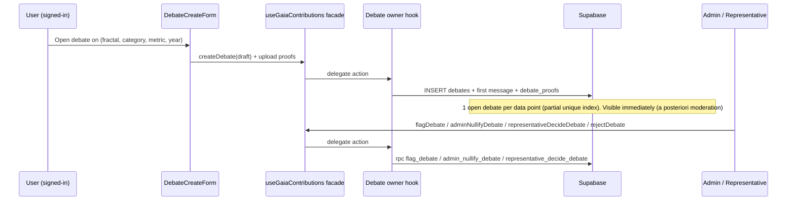
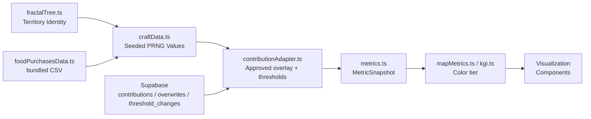

# Architecture Documentation — Gaïa Equation

> **Audience**: Developers, architects, and technical stakeholders onboarding onto the project.
> **État au**: 2026-07-08 — décrit le code réel. Voir `context-gaia-dev` (source de vérité) et
> `.agents/skills/gaia-codebase-map/SKILL.md` (carte d'ensemble) en cas de doute.

---

## 1. Executive Summary

Gaïa Equation is a **single-page React app** for visualizing environmental footprints (surface,
energy, carbon) across a fractal hierarchy of territories — from Earth (L1) to neighbourhood blocks
(L9). Stack: **React 19 + Vite + Tailwind 4 + D3-Geo/D3-Hierarchy**, with **Supabase**
(PostgreSQL + Auth + Storage + RPC) as an integral backend for everything that changes at runtime:
authentication, profiles, roles, contributions, live overwrites, debates, and threshold governance.

The core architectural principle is **data-interface stability**: visualization components consume
the same `FractalData` + `MetricSnapshot` shapes regardless of whether a value comes from the local
craft generator, the bundled food/purchases CSV, or the Supabase live layer.

---

## 2. System Architecture

```mermaid
graph TB
    subgraph "Browser (Client-Side)"
        UI[App.tsx — thin shell]
        Header[AppHeader.tsx]
        Router[AppViewRouter.tsx]
        Explorer[ExplorerView.tsx]
        Map[MapChart.tsx — D3-Geo]
        Tree[TreemapChart.tsx — D3-Hierarchy]
        Bar[Benchmark1DChart.tsx]
        Iso[Isocurve2DChart.tsx — case 1]
        ThreeD[ThreeDChart.tsx]
        Col[ActiveRegion3DColumn.tsx]
        Contrib[ContributionPanel.tsx]
        Rep[RepresentativePanel.tsx]
        Admin[AdminPanel.tsx]
        Debate[DebateChannel / DebateList / DebateCreateForm]
        Account[AccountPanel.tsx]
    end

    subgraph "App-level hooks"
        Nav[useAppNavigation]
        Expl[useExplorerState]
        Draft[useLiveOverwriteDraft]
    end

    subgraph "State spine"
        Hook[useGaiaContributions.ts facade]
        Owners[gaiaContributions/* owner hooks]
    end

    subgraph "Data Layer (TypeScript modules)"
        FTree[fractalTree.ts — Territory hierarchy]
        Craft[craftData.ts — Seeded PRNG generator]
        Food[foodPurchasesData.ts — bundled CSV]
        Adapter[contributionAdapter.ts — overlay + thresholds]
        Metrics[metrics.ts — MetricSnapshot]
        MapMetrics[mapMetrics.ts — color tiers]
        Thr[thresholds.ts — resolver]
        KGI[kgi.ts]
        FMap[fractalMap.ts — GeoJSON ↔ fractal mapping]
    end

    subgraph "Static Assets"
        Geo["/public/geo/*.geojson"]
    end

    subgraph "Supabase backend"
        Supa[(Auth · Profiles · Roles · Contributions · Overwrites · Debates · Thresholds · Storage 'proofs')]
    end

    UI --> Header & Router & Explorer
    Explorer --> Map & Tree & Bar & Iso & ThreeD & Col
    Router --> Contrib & Rep & Admin & Debate & Account
    UI --> Nav & Expl & Draft
    UI --> Hook
    Hook --> Owners
    Owners --> Supa

    Map --> FMap
    FMap --> Geo
    FMap --> FTree

    UI --> Metrics
    Metrics --> Adapter
    Adapter --> Craft
    Adapter --> Thr
    Craft --> FTree
    Craft --> Food
    Map --> MapMetrics
```



---

## 3. Component Architecture

### 3.1 App.tsx — Thin Shell

`src/App.tsx` is now a **thin shell** (~125 lines) with **no routing library**. It calls the state
spine facade (`useGaiaContributions`) once, wires three app-level hooks on top of it, and renders
either the explorer or the routed panel view:

| Hook | File | Owns |
|------|------|------|
| `useAppNavigation` | `src/hooks/useAppNavigation.ts` | `appView`, debate return-view, view transitions (`openDebate`, `submitDebate`, `backToExplore`, `backFromDebate`) |
| `useExplorerState` | `src/hooks/useExplorerState.ts` | `activeType`, `activeCategory`, `activeYear`, `visualMode`, `mapDisplayMode`, `selectedFractalId`, `mapContextId`, drill-down handlers |
| `useLiveOverwriteDraft` | `src/hooks/useLiveOverwriteDraft.ts` | The live-overwrite form draft (open manually or pre-filled from an accepted debate), validation, submit |

`App.tsx` itself keeps only the theme toggle (`localStorage` key `gaia-theme`) and a couple of
callbacks that cross hook boundaries (`openOverwriteFromDebate`, `handleRepresentativeDecision`).
It renders:

- **`AppHeader`** (`src/components/app/AppHeader.tsx`) — top nav, role-aware menu entries, pending-total
  badge, theme toggle.
- **`ExplorerView`** (`src/components/explorer/ExplorerView.tsx`) when `appView === 'explore'` — composed
  of `ExplorerFilters`, `ExplorerViewport`, `ExplorerInstructions`, `ExplorerLegend`, plus
  `SelectedTerritoryDetails` and `LiveOverwriteForm` for the detail/edit flow.
- **`AppViewRouter`** (`src/components/app/AppViewRouter.tsx`) for every other `appView` — a sequence of
  `if (appView === …)` returns, one per panel.

**View → component** (via `AppViewRouter`): `account → AccountPanel` · `contribute → ContributionPanel` ·
`admin → AdminPanel` · `representative → RepresentativePanel` · `debate → DebateChannel` ·
`create-debate → DebateCreateForm` · `debates → DebateList` · `explore` is handled directly by
`App.tsx` via `ExplorerView`, not by the router.

`src/utils/explorerSelection.ts` holds the shared `AppView` / `ActiveType` / `VisualMode` /
`MapDisplayMode` types plus `TYPE_LABELS` and the `buildSelectedTerritoryDetails` helper — the
contract both `App.tsx` and its child hooks/components import against.

> Note: two footprint vocabularies coexist — `EmpreinteType = 'gaia' | 'energy' | 'carbon'`
> (English, in `types.ts`) vs the French keys `gaia | energie | carbone` used at runtime in
> `constants.ts` and `activeType`. Match the one used at the call site.

### 3.2 Visualization Components

The explorer offers several readings of the same footprint datum:

| Component | File | Purpose |
|-----------|------|---------|
| `MapChart` | `components/MapChart.tsx` | D3-Geo choropleth, click to select / double-click to drill down |
| `TreemapChart` | `components/TreemapChart.tsx` | D3-Hierarchy population rectangles (sub-mode of `cartes`) |
| `Benchmark1DChart` | `components/Benchmark1DChart.tsx` | Population-width bars, 1993/2023/2050 trajectories |
| `Isocurve2DChart` | `components/Isocurve2DChart.tsx` | 2D isocurves — **case 1 only** (énergie hors mobilité) |
| `ThreeDChart` | `components/ThreeDChart.tsx` | SVG 3D view (measures its own container) |
| `ActiveRegion3DColumn` | `components/ActiveRegion3DColumn.tsx` | Compact 3D column of the active fractal, left sidebar |

### 3.3 The four data flows

Data behavior enters the UI through the **state spine facade** `src/hooks/useGaiaContributions.ts`.
`App.tsx` calls it once and threads the result down as `contributionState`; the public field/action
contract stays stable there. The implementation is split by domain under
`src/hooks/gaiaContributions/` (auth/profile, responsibilities/directory,
contributions/overwrites, debates+thread, threshold changes, and topology). The earlier flat
**comments** system has been **replaced by debates** (the `review_comment` RPC is dropped in the
debates migration).

| Flow | What it is | Who | DB tables |
|------|-----------|-----|-----------|
| **Representative CSV import** | Wide-CSV export → offline edit → strict, atomic import (spec 019); one `source_label`/`source_url`/`justification` per changed cell (data/vital/limit); years 1900–2100 | responsable, exact assigned fractals only (no prefix inheritance) | `representative_import_batches`, `representative_import_cells` |
| **Overwrites** | Live single-cell corrections, applied immediately, admin can reject after | responsable (exact fractal) / admin | `data_overwrites` |
| **Debates** | Text channels arguing a datapoint, with proof uploads + resolution | anyone signed-in | `debates`, `debate_messages`, `debate_participants`, `debate_proofs` (+ Storage bucket `proofs`) |
| **Thresholds** | Govern global **limits** (admin) and fractal **vitals** (responsable, direct attribution) | admin / responsable | `threshold_changes` |

> The legacy `contributions` table (pending → approved/rejected, admin-reviewed) is **no longer
> written to**. Rows already there are still read for historical overlay/compat, but the review queue,
> `submitContribution`, and `reviewContribution` were removed in spec 019 — see
> [Rôles & contributions](#/roles-et-contributions).

```mermaid
sequenceDiagram
    participant R as Responsable
    participant CP as ContributionPanel
    participant Csv as contributionCsv.ts
    participant Hook as useGaiaContributions facade
    participant Flow as Contribution owner hook
    participant SB as Supabase
    participant CA as contributionAdapter

    R->>CP: Exporter CSV (exact assigned fractals only)
    CP->>Csv: buildRepresentativeExportRows(...)
    R->>CP: Importer un CSV modifié
    CP->>Csv: parseCsv + validate (per-cell source/URL/justification, year 1900-2100)
    Csv-->>CP: RepresentativeImportValidationReport (changed/unchanged/blank/errors)
    R->>CP: Publier toutes les cellules
    CP->>Hook: publishRepresentativeImport(fileName, rowCount, cells)
    Hook->>Flow: delegate action
    Flow->>SB: RPC publish_representative_import(...) — atomic batch insert
    Note over SB: SQL mirrors can_manage_fractal(): exact fractal only, no prefix inheritance
    CA->>SB: FETCH representative_import_cells + data_overwrites + threshold_changes
    CA-->>CA: Overlay onto craftData, resolve thresholds
    Note over CA: Merged data flows to all viz components; last publication wins per cell
```



**Scope rule (spec 019)**: fractal IDs are still prefix-nested for display/inheritance (`1.2.2`
contains `1.2.2.1.1`…), but **editing scope is exact-fractal only** — a responsable of fractal X can
edit X, and only X, not its descendants. Checked by `can_manage_fractal()` in SQL and mirrored by
`isFractalWithinScope()` in `contributionSchema.ts` (`responsibilities.includes(fractalId)`, no prefix
match). "Responsable" is **derived** from rows in `fractal_responsibilities` (no self-assignable enum);
a compte can hold several exact attributions at once. Reading a vital/limit still falls back to the
nearest ancestor that has one — that inheritance is read-only.

---

## 4. Data Architecture

### 4.1 Data Flow Pipeline



### 4.2 Territory Identity — `fractalTree.ts`

The fractal tree is the **single source of truth** for territory topology, defined as a flat array
in TypeScript. L1 (Earth, id `'1'`) → L2 subcontinents (`1.x`) → L3 macro-regions (Europe only in
the MVP, `1.2.x`) → L4–L9 a France-first demo branch (Paris, Lyon, Marseille, Toulouse).

- **Fractal IDs** use dot notation: `1.2.2.1.1.1` = France → Île-de-France → Paris → 18th → Clignancourt
- Each territory references its **GeoJSON feature** via `geoFeatureId` (string or array)
- `geoStrategy: 'union'` merges multiple polygons (e.g. trans-border France + Swiss Romande)
- Lookup is O(1) via a `Map<string, FractalTerritory>` built at module load
- Exported helpers: `getTerritory`, `getChildren`, `getParent`, `getBreadcrumb`, `getTerritoriesByLevel`

### 4.3 Craft Data Generator — `craftData.ts`

Generates **deterministic** data for every territory × year using a seeded PRNG: same
`fractalId + year` always yields identical values (reproducible UI debugging). Layered overrides
add real European mobility values and the bundled food/purchases data
(`foodPurchasesData.ts`, imported from `templates/food-purchases-l9-data.csv?raw`). Parent values
are population-weighted aggregates of children.

> `src/data/mockData.ts` still exists but is **deprecated/unused** — superseded by `craftData.ts`.

### 4.4 GeoJSON Source Registry — `geoSources.ts`

Maps dataset keys to GeoJSON file paths and property names (e.g. `worldCountries`,
`franceRegions`, `franceDepartments`, `franceCommunes`, `parisArrondissements`, `parisQuartiers`,
`lyonArrondissements`, `marseilleQuartiers`). Files live in `/public/geo/`.

### 4.5 Map Layer Construction — `fractalMap.ts`

Transforms `(contextId, GeoJSON datasets) → MapLayerData` via `getMapLayerData()`, routing on the
`contextId` to specific builder functions (`ROOT_MAP_CONTEXT_ID = '1'`). This layer is currently
**France-specific** (Paris/Lyon/Marseille/Toulouse `if` chains) — a known tech-debt item tracked in
`roadmap-status.md`. When no GeoJSON exists at low levels, the system generates **synthetic
grid-cell polygons** by subdividing the parent feature.

### 4.6 Data Ingestion Pipeline (`.ods`)

A Python pipeline (`scripts/ingest_gaia_ods.py`, `npm run ingest:gaia`) converts a human-editable
`.ods` workbook into normalized CSV/JSON in `data/ingestion/` (`territories.csv`,
`territory_populations.csv`, `metric_observations.csv`, `fractal_data_api.json`,
`ingestion_report.json`), using an explicit mapping (`scripts/gaia_ingestion_mapping.csv`). Tested
by `npm run test:ingestion`. **It is not yet wired to the displayed data** — see
[Sources de données](#/sources-de-donnees) and `roadmap-status.md`.

---

## 5. Metric & Threshold Pipeline

### 5.1 metrics.ts — MetricSnapshot

`getMetricSnapshot(data, activeType, activeCategory) → { value, vital, limit, reason }` resolves the
12 metric paths (3 types × 4 categories). For Gaïa categories it returns a **ratio**
(`value / vital`, with `vital = 1`). `getMetricAvailability()` structurally blocks **only
`carbone × mobility`** ("donnée source non validée"); other combinations return a `reason` per
territory/year when the underlying value is `null`.

### 5.2 Thresholds — `thresholds.ts` + governance

System default thresholds live in `constants.ts` (`THRESHOLDS`). Governed overrides are an
**append-only event stream** in the Supabase table `threshold_changes`:

- **Global limit** (`threshold_kind = 'limit'`, `fractal_id = NULL`) — admin only.
- **Fractal vital** (`threshold_kind = 'vital'`, `fractal_id` required) — responsable with direct
  attribution, current calendar year only.

`src/utils/thresholds.ts` resolves the effective value (`resolveEffectiveThreshold`,
`resolveThresholdPair`, `applyEffectiveThresholds`, `getSystemThresholdYear`; covered by
`thresholds.test.ts`, run via `npm run test:thresholds`). Resolution is **non-retroactive** (a
threshold doesn't change anything before its effective year) and walks up ancestors before falling
back to the system default.

### 5.3 Color tiers — `mapMetrics.ts` / `kgi.ts`

`colorTier(value, vital, limit)` → `'below' | 'normal' | 'above'`, rendered as:

| Tier | Color | Constant |
|------|-------|----------|
| below vital | Blue `#3b82f6` | `BLUE_COLOR` |
| in range | Footprint color (gaia `#8b5cf6` · énergie `#A0522D` · carbone `#6b7280`) | `FOOTPRINT_COLORS` |
| above limit | Red `#dc2626` | `RED_COLOR` |

**Red priority**: a limit overshoot stays red even when a custom vital is set.

---

## 6. Supabase Backend

- **Client**: `src/lib/supabaseClient.ts` (`supabase`, `isSupabaseConfigured`). Frontend uses the
  **anon key + Row-Level Security** only; no service role is exposed.
- **Tables**: `profiles` (role `citizen`/`entity`/`admin`), `fractal_responsibilities`,
  `contributions`, `data_overwrites`, `debates` + `debate_messages` + `debate_participants` +
  `debate_proofs`, `admin_debate_escalations`, `threshold_changes`. Storage bucket `proofs`
  (mime / 10 MB / max 5 files per debate).
- **RPCs in use**: `can_write_in_debate`, `flag_debate`, `admin_nullify_debate`,
  `representative_decide_debate`, `submit_debate_creator_feedback`, `submit_overwrite_from_debate`,
  `admin_directory`, `set_global_limit`, `reset_global_limit`, `set_fractal_vital`, `reset_fractal_vital`.
- **Migrations** are applied **manually** (SQL editor / CLI), in order, from `supabase/migrations/`
  (see `supabase/README.md`). They do **not** auto-deploy on merge. RPCs granted only to
  `authenticated` are invisible to the anon key — that is not proof of absence.
- Feature maps: debates → `specs/006-data-debates/MAINTENANCE.md`; thresholds →
  `specs/009-threshold-governance/MAINTENANCE.md`.

---

## 7. Key Design Decisions

- **No routing library** — `appView` replaces routing for the top-level screens. Simple for a
  prototype; revisit as the app grows.
- **Deterministic craft data** — seeded PRNG keeps development builds reproducible.
- **Swappable data interface** — viz components depend on `FractalData` / `MetricSnapshot`, not on a
  data source, so the source can change without touching the charts.
- **Append-only governance** — thresholds are an event log, not in-place edits, preserving history
  and enabling non-retroactive resolution.
- **Server-enforced permissions** — the UI hides forbidden actions, and Supabase RLS re-checks every
  write; scope is an **exact fractal-ID match** (`can_manage_fractal()`), mirrored client-side by
  `isFractalWithinScope()` — no prefix inheritance for editing since spec 019.

## 8. Open Items

Tech-debt and not-yet-built items are tracked in `roadmap-status.md` (e.g. wiring the `.ods`
pipeline to the display, making `fractalMap.ts` fractal-agnostic, fully data-driven GeoJSON config).

---

## 9. Appendix

### 9.1 Build · test · run

| Command | Description |
|---------|-------------|
| `npm run dev` | Vite dev server with HMR → **http://localhost:5173** |
| `npm run build` | `tsc -b && vite build && cp -R docs dist/docs` (docs shipped with the app) |
| `npm run preview` | Serve the production build |
| `npm run lint` | ESLint (`noUnusedLocals`/`noUnusedParameters` are on) |
| `npm run test:thresholds` | Node test runner over `src/utils/thresholds.test.ts` |
| `npm run ingest:gaia` / `npm run test:ingestion` | Python ingestion pipeline + its tests |

### 9.2 Glossary

| Term | Definition |
|------|-----------|
| **Fractal** | A self-similar territorial unit; each parent targets ~12 children (6–18) |
| **KGI** | Key Gaïa Indicator — the primary measurement for a territory |
| **Vital** | Minimum threshold for human well-being (blue floor) |
| **Limit / Limite** | Maximum sustainable threshold (red ceiling) |
| **Craft data** | Deterministic placeholder values (not organic measurement) |
| **Representative CSV import** | Wide-CSV export/edit/import batch, atomic publish, no admin review (spec 019) |
| **Contribution** *(legacy)* | Old proposed-value-pending-admin-review record (`contributions` table); no longer created, still read for historical overlay |
| **Overwrite** | Live single-cell correction, active immediately, admin can reject |
| **Debate** | Text channel arguing a datapoint, with proofs and resolution |
| **Responsable** | User with ≥1 row in `fractal_responsibilities`, scoped to the **exact** fractal(s) held — no dotted-prefix inheritance for editing (spec 019) |
| **L9** | Leaf-level territory ("Proches"), ~25 people |
| **Synthetic feature** | A generated polygon when real boundaries are unavailable |

### 9.3 Production Dependencies (selected)

| Package | Version | Usage |
|---------|---------|-------|
| `react` / `react-dom` | `^19.2.4` | UI framework |
| `@supabase/supabase-js` | `^2.105.4` | Auth, DB queries, RPC, storage |
| `d3-geo` | `^3.1.1` | Map projections / paths |
| `d3-hierarchy` | `^3.1.2` | Treemap layout |
| `lucide-react` | `^0.577.0` | Icons |
| `vite` | `^8.0.0` | Dev server + bundler |
| `typescript` | `~5.9.3` | Static typing |
| `tailwindcss` | `^4.2.1` | Styling |

The `ingest_gaia_ods.py` script uses the Python **standard library only** (`xml.etree`, `zipfile`,
`sqlite3`, `csv`, `json`, `argparse`, `dataclasses`) — no pip packages.
